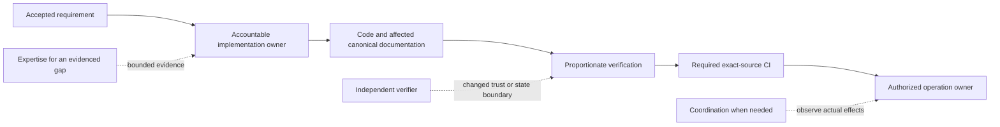

# Agents

## Why BetStan uses agents

BetStan's reusable agents are bounded capabilities, not a required sequence
or approval hierarchy. One accountable owner retains the accepted scope,
implementation, verification evidence, and next action.

An agent status is never permission to merge or deploy. GitHub branch
protection, exact-SHA checks, protected environments, and the release workflow
remain authoritative.

The [agent-team README](https://github.com/vasilyevstan/betstan/blob/master/.github/agents/README.md)
owns capability routing and evidence reuse;
[CONTRIBUTING.md](https://github.com/vasilyevstan/betstan/blob/master/CONTRIBUTING.md)
owns branch and origin-bound approval policy. This page explains those
responsibilities rather than adding gates. Editing repository instructions
does not reload an already-running session or activate a new controller.

## Proportionate verification

| Change | Verification |
|---|---|
| Ordinary bounded, reversible work | Relevant existing tests, inspection, or build checks |
| Documentation-only work | Applicable documentation link and contract checks |
| Trust or state boundary | Independent verification of the changed authorization, CI trust, release authority, writer ownership, data integrity, migration, or recovery boundary |

Required current-SHA CI and applicable runtime checks remain in force. The
author cannot supply their own independent verification. Implementation,
verification, and privileged execution are responsibilities, not a requirement
for a separate agent at each step.

There is no compulsory architect/simplifier/developer/critic/test-engineer/
final-validator conveyor, model quorum, unanimity veto, review-of-review, or
duplicate test handoff. Select expertise for a concrete acceptance gap, not
because a role exists. Missing required evidence blocks its dependent action;
absence of an optional role's status does not.

## Engineering capabilities

| Agent | Role | Mode |
|---|---|---|
| `betstan-architect` | Resolves an evidenced design question, boundaries, compatibility, and acceptance criteria | Read-only |
| `betstan-simplifier` | Challenges unnecessary scope or abstraction; returns a bounded recommendation | Read-only |
| `betstan-backend-developer` | Implements bounded TypeScript service, shared-contract, RabbitMQ, MongoDB, migration, and backend-test changes | Repository editor |
| `betstan-frontend-developer` | Implements bounded React, SSE, responsive, accessible, and client-test changes | Repository editor |
| `betstan-validation-critic` | Independently verifies concrete correctness, concurrency, or trust-boundary risks | Read-only |
| `betstan-test-engineer` | Supplies focused executable verification and identifies evidence gaps | Read-only |
| `betstan-final-validator` | Reconciles aggregate evidence when unresolved cross-domain risk needs it | Read-only |

Each editor stays within assigned paths. Infrastructure and governance work
remain with their authorized owners. The public-wiki editor returns owned
canonical pages and evidence directly to the accountable implementation owner.

File-editing developers are not Git actors. They do not merge, push, approve,
or deploy; the authorized orchestrator creates the complete immutable
candidate.

## Orchestration

| Agent | Role | Mode |
|---|---|---|
| `betstan-conductor` | Observes parallel, asynchronous, external, or mutating work; tracks dependencies, real progress, and bounded recovery | Read-only by default; narrowly governed edits only for a proven self-imposed policy defect |
| `PerfettoStan` | When requested for process friction, returns a smaller safe continuation directly to the owner | Read-only |

Use the conductor only for parallel, asynchronous, external, or mutating work
that needs checkpoints and recovery. A single synchronous implementation and
validation trace stays with its owner. When registered, the conductor
distinguishes activity from progress. A running process, growing log, or
watcher is not a deliverable. It checks the underlying job, approval, agent
result, or handoff and assigns one owner for the next action.

PerfettoStan is optional, not a prerequisite to starting or resuming work.
The accountable owner may remove unsupported duplication directly; no
PerfettoStan-to-simplifier continuation is required. Process simplification
cannot bypass branch protection, exact-SHA validation, required independent
evidence, locks, fences, provenance, rollback, or active incident-safety work.

Routine scope, routing, receipt acknowledgements, and timers belong to the
owner or assigned conductor, not a critic queue. It returns obvious scope violations to their
native owner and consults the retained critic only for substantive ambiguity.
Missing advisory work blocks only its affected dependants: independently
authorized observation, eligible approval, safe completion, and incident
recovery continue. Missing required technical evidence still blocks the
operation that needs it. The conductor routes eligible approvals to the
authorized orchestrator; it does not submit approvals itself.

The conductor does not duplicate a slow agent, silently reset a deadline, or
weaken a real safety gate. If a repository rule itself creates a proven false
block, the same work unit may correct only that rule and its focused tests
through the normal branch path.

At the existing 15-minute no-progress investigation checkpoint, report the
bounded result or concrete blocker and smallest safe next action. Repeated
plans, hypotheses, tool calls, or status updates alone are not progress. This
checkpoint does not shorten a genuine provider wait or waive a safeguard.
Once a slice is accepted, keep its feature/design scope fixed during release;
continue required safety work and only the smallest correction for an
observed blocker. See [[Release Orchestration]] for owned operational waits.

After a successful deployment but failed acceptance, the conductor records the
exact assertion and distinguishes application, harness, and provider causes
before routing only the affected correction. Once scoped completion criteria
pass, it closes the unit rather than adding reviews, status-only
handoffs, or another release. See [[Engineering Learnings]] for these lessons.

It also treats concurrent feature delivery as normal. A session records the
commits its outcome requires, while the release candidate may contain
additional protected work. The conductor adopts the exact current `master`
only after ancestry and complete-candidate validation, and it keeps live
production mutations serialized.

## Product and engineering specialists

| Agent | Trigger | Role |
|---|---|---|
| `betstan-public-wiki-editor` | Documentation expertise is needed for public impact | Returns the smallest relevant canonical page update and evidence; requires authorized post-merge publication but does not publish |
| `betstan-ux-ui-expert` | Evidenced design, accessibility, responsive, or interaction risk | Supplies a consistency specification, result review, or both, as assigned |
| `betstan-service-contract-reviewer` | HTTP, JWT, message, persistence, or shared-package boundary change | Traces producer, consumer, data, compatibility, and affected-test impact |
| `betstan-quality-gate-reviewer` | CI, coverage, branch protection, or false-green risk | Verifies gates are reproducible, complete, and attached to the intended change |
| `betstan-branch-governance-reviewer` | Branch, PR, ancestry, or exact-SHA question | Verifies allowed source/target flow and trusted status provenance |
| `betstan-auth-security-reviewer` | Authentication, session, identity, or authorization change | Reports high-confidence exploitable auth/security defects without editing |

This catalog is not an invocation checklist. Every change records documentation
impact, which the owner may assess directly. User-facing changes retain
source-bound consistency evidence and appropriate rendered checks without a
compulsory two-phase UX handoff. See [[UI UX Consistency]].

## Deployment, runtime, and migration specialists

| Agent | Trigger | Role |
|---|---|---|
| `betstan-deployment-safety` | PR, CI/CD, exact-SHA deployment, rollback, or post-merge work | Owns release safety, provenance, rollback readiness, and deployed-state conclusions |
| `betstan-oci-operator` | OCI-owned repository work or exactly authorized runtime operation | Edits only owned source for repository work; diagnoses runtime work first and performs only the authorized bounded operation |
| `betstan-oci-health-reviewer` | OCI deployment or health assessment | Independently checks exact provenance, routing, workloads, data, broker, and cost constraints |
| `betstan-domain-ingress` | DNS, TLS, redirect, ingress, or load-balancer change | Protects canonical routing and diagnostic separation |
| `betstan-mongo-migration` | Shared-Mongo migration, cleanup, rollback, or recovery | Preserves journal, lock, topology, and data safety |
| `betstan-migration-recovery` | Interrupted cross-cloud replacement | Recovers the existing migration state rather than starting a competing operation |

The former Azure agents (AKS operator, Azure cost analyst and Azure
retirement) are archived because BetStan no longer runs on Azure.

Mutation-capable runtime agents begin with diagnosis and require exact scope,
authority, rollback, and stop conditions. They do not treat a broad request as
permission for unrelated production changes.

Deployment safety brings applicable configuration and publication-prerequisite
checks forward, preserves the bounded same-authority approval rules, and
verifies final artifact bytes, committed/no-lease state, and post-upload cleanup. The lessons in
[[Engineering Learnings]] refine execution of [[Release Orchestration]]; they do
not add gates or expand production authority. Exact runtime authorization
follows the CLI-owned automatic versus human-origin approval boundary in
[[Release Orchestration]].

Five specialists retain manual-only invocation: domain/ingress, migration
recovery, Mongo migration, OCI health reviewer, and OCI operator. Model
routing must not invoke them automatically;
manual invocation itself is not runtime authorization.

Repository-only work reports its source changes and local validation, not a
live health conclusion, and does not require unrelated provider operations.
Runtime work retains all checks for its selected runtime and procedure: AKS
topology-journal requirements are not OCI release prerequisites, and k3s
identity validation does not require an OKE configuration. In-runtime Mongo
consolidation and cross-cloud migration retain their own identity, backup,
compatibility, lock/fence, and rollback evidence.

## Evidence and actual transfers

Keep one existing task record with the accepted request, exact source/diff,
scope, acceptance criteria, ownership, commands/results, limitations, and next
action. Active external work also needs an exact run/process reference,
checkpoint, stop condition, and recovery action. Do not create a second ledger
or acknowledgement-only work unit.

When a transfer is actually needed, return the result directly to the next
owner. Findings name the concrete mismatch, consequence, and smallest
correction. Keep corrections with the original owner where available and
reopen only evidence invalidated by changed source, dependencies, criteria, or
an unresolved finding. Never replace an operation until its effects are known
and overlapping writers are excluded.

Supporting measurements prove only their stated claims. They need no prior
UX/critic verdict or duplicate test round and do not establish independent
verification, whole-candidate acceptance, or runtime health by themselves.
Keep private evidence references out of this handbook; see [[Security]].

For scoped-fixture or additional-page harness corrections, the test engineer
follows [[Engineering Learnings]] on actual helpers, fixture isolation,
identity-faithful request mocks, observable form restoration, and drained,
precisely attributed error audits. Mock-browser results do not establish
production acceptance.

### Resuming accepted reviews

The canonical reuse policy is **Evidence and reuse** in
[the agent-team README](https://github.com/vasilyevstan/betstan/blob/master/.github/agents/README.md).
A crash, pause, compaction, new PR, promotion, or ancestry synchronization
alone does not invalidate a completed source review. Recover its original
SHA, base, scope, criteria, report, verdict, and limitations;
missing evidence must not be invented or relabelled as a new-head review.

Reuse requires proof that the relevant inputs, dependencies, criteria, and
current policy remain applicable. Reopen only invalidated evidence and its
dependants, keeping the same owner context when available. Required
exact-current-SHA CI, merge-snapshot checks, runtime acceptance, provenance,
and approval controls remain current. Record the justification in the
existing handoff, not a new ledger.

## Model diversity

Multi-model deliberation is optional unless explicitly requested. Reuse
accepted synthesis rather than repeating a completed design discussion.
Disagreements are decided by the accountable owner against requirements and
evidence, not unanimity. Model agreement is not implementation proof and cannot
remove safety, compatibility, data integrity, or rollback obligations.

## Agent selection guide

1. Assign one accountable owner with the required path and action authority.
2. Inspect the exact diff and reuse applicable accepted evidence.
3. Choose proportionate verification; independently verify changed trust/state
   boundaries.
4. Record documentation impact and affected UI consistency evidence.
5. Add expertise or coordination only for a concrete gap.
6. Keep current exact-source checks and origin-bound operation controls.
7. Report actual results and the exact next owner without status-only handoffs.

## Related pages

- [[Quality Gates]]
- [[Release Orchestration]]
- [[Security]]
- [[UI UX Consistency]]
- [[Engineering Learnings]]
