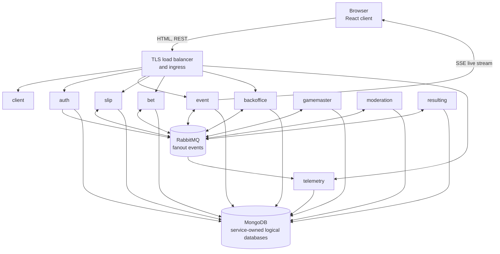
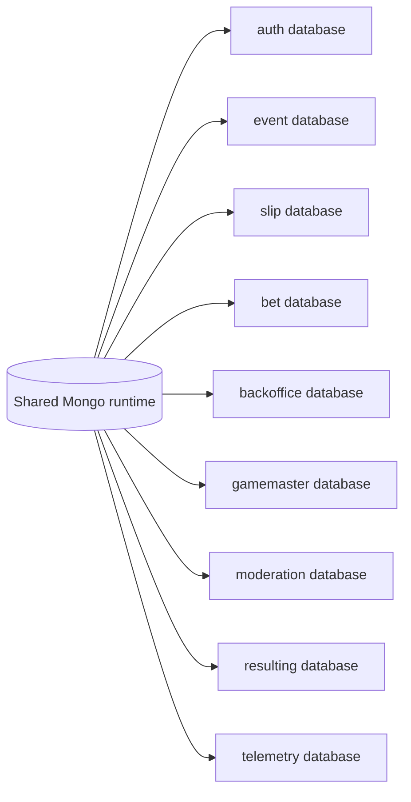

# Architecture

## Architectural style

BetStan is a TypeScript and JavaScript microservice system with:

- a React single-page application;
- six HTTP-facing backend services, in addition to the client;
- three internal event-driven workers;
- RabbitMQ fanout messaging;
- one persistent MongoDB runtime with a separate logical database per backend
  service;
- a versioned `@betstan/common` package for shared wire contracts,
  middleware, errors, and message infrastructure.

Services own their persistence and behavior. Other services integrate through
HTTP or versioned events rather than reading another service's collections.
The only cross-database reads are bounded, offline maintenance checks executed
with application writers quiesced and the shared database operation lock held.

## Component diagram

## Service catalog

| Service | Interface | Responsibility | Owned data |
|---|---|---|---|
| `client` | HTTP | React UI, navigation, event cards, betting boards, My Bets, statistics, and Backoffice | Browser/session state only |
| `auth` | HTTP | Signup, login, logout, current-user resolution, password verification, session issuance, and authoritative role verification | Users and login-attempt records |
| `event` | HTTP, SSE, AMQP | Scheduled event catalog, public read model, odds selection, live projection, and live-stream fanout | Event catalog and live projection |
| `slip` | HTTP, AMQP | Independent live/pre-match draft boards, placement concurrency, and reliable submission publication | Draft/submitted slips and publication state |
| `bet` | HTTP, AMQP | User-visible bet ledger, moderation state, row/final result, payout data, and statistics | Bets, conflicts, and pending updates |
| `backoffice` | HTTP, AMQP | Public event creation, visibility, manual result controls, and durable publication replay | Operational event records and publication markers |
| `telemetry` | HTTP, inbound AMQP | Best-effort bounded operational summaries and application service health snapshots | Telemetry metric records |
| `gamemaster` | AMQP worker | Deterministic accelerated football simulation, incidents, score, quotes, market versions, and final result | Simulation state and completed archives |
| `moderation` | AMQP worker | Slip, phase, market, quote, and mixed-kind validation | Mirrored authority, parked requests, and moderation records |
| `resulting` | AMQP worker | Pre-match and live row settlement, final slip result, retries, and replay | Settlement ledgers, archives, and retry state |

## Data ownership

The production runtime uses one persistent MongoDB instance for operational
efficiency, but each backend service has its own logical database and schemas.
The shared physical server is not shared ownership.

This boundary supports:

- independent schemas and indexes;
- service-local migrations;
- message-based consistency between domains;
- compatibility testing during rolling deployment;
- recovery without cross-service collection access.

### Telemetry's observation store

Telemetry owns a logical database on the shared MongoDB runtime. It stores
only a deduplication key, an allowlisted metric, and the occurrence time, not
the original business message. Keys are random observation IDs for page
visits and Auth/Slip reports, or hashes of domain identity for observed
submission, settlement, and live-update messages. Insert-only upserts preserve
the first recorded occurrence on duplicate delivery.

A MongoDB TTL index makes records eligible for deletion 30 days after
`occurredAt`; deletion is asynchronous, not an exact wall-clock deadline.
Daily counts are aggregated on request over the current UTC day and preceding
13 days, rather than stored as a separate reporting warehouse. Service health
is probed on summary refresh and is not persisted as a history.

Telemetry never reads other services' collections or publishes business
decisions. Its HTTP listener starts only after MongoDB, indexes, RabbitMQ,
and its consumer are initialized; losing the consumer shuts the observer down
instead of leaving an apparently working HTTP-only process. Its best-effort
delivery exceptions are described in [[Message Flows]], and the public API and
counting semantics in [[Application Processes]].

## Synchronous and asynchronous boundaries

### Synchronous HTTP

HTTP is used for browser-facing commands and queries:

- authentication and current-user lookup;
- event catalog, odds selection, and SSE connection;
- slip query and submission;
- bet history and statistics;
- public Backoffice commands;
- bounded Telemetry summaries and service-health snapshots.

The Event service also performs a bounded internal Auth verification when an
administrator requests access to explicitly scoped offline acceptance data.

### Asynchronous RabbitMQ

RabbitMQ carries domain facts such as:

- an event was created or had visibility changed;
- odds were selected;
- a slip was submitted;
- moderation accepted or rejected a slip;
- a live match advanced;
- an event reached a final result;
- a row or complete slip was settled.

Telemetry is a best-effort observer of these facts. It is never the authority
for betting, accounts, or settlement, and reporter failure cannot block
signup, login, or slip workflows.

Delivery is treated as at-least-once. Consumers therefore use idempotent
writes, monotonic versions or sequences, durable pending records, and replay
workers rather than assuming one delivery in perfect order.

### Server-Sent Events

The Event service exposes live updates to connected browsers through SSE.
Transient output buffering is tolerated within fixed byte and drain-time
limits; consumers that remain stalled or exceed the buffering budget are
disconnected. The stream remains a low-latency projection, not the durable
source of truth. Clients continue to reconcile important terminal state
through the authoritative REST read model.

## Shared contract package

`common/src/` is the canonical source for the next `@betstan/common` release.
Deployable services consume an immutable published package version. Changing a
wire contract therefore requires:

1. additive or explicitly migrated schema design;
2. old/new producer-consumer compatibility analysis;
3. package build and packed-artifact validation;
4. a separate reviewed publication;
5. explicit consumer repinning.

Source appearing in the repository does not silently alter a deployed
service.

### Reusable markets

The `1.1.0-rc.3` Common candidate defines reusable market templates, event-bound
versions, generated-odds previews, frozen selections and revision-bound manual
decisions. Compatible service source implements authoring, pricing, acceptance,
settlement and history. Source delivery is not runtime activation.

`EXTENSIBLE_MARKETS_ENABLED` defaults to false in Backoffice, Event, Slip and
Moderation code; the deployed manifests set it to true. When enabled in a
compatible generation,
scheduled and Backoffice-created events retain their original model, typed rules
for standard selections and a durable model-publication obligation. Replaying
creation does not replace a retained model or invent one for an existing legacy
event. These internal fields are excluded from ordinary catalog queries.

Backoffice owns immutable template versions and event-embedded market
configurations. Parameter bindings freeze when publication is requested.
Draft edits do not replace the previous successful projection; a publishing
revision blocks new acceptance until Event acknowledges that exact configuration.
Archive operations prevent new template instances, never delete historical
authority. Configuration and manual-decision sends retain durable publication
obligations and coalesce concurrent local sends without claiming exactly-once
transport.

Visual layouts are optional Backoffice-owned presentation metadata, stored in
a top-level version-keyed `layouts` map and copied to the event market on
creation. Persisted template `versions` remain byte-shape compatible with
predecessor writers, which copy them directly into strict shared payloads.
The public template DTO joins each version's layout for authoring.
The layout contains only bounded grid coordinates, spans, corner shape and
outcome keys; the server rejects overlaps and missing or duplicate outcomes.
Template request fingerprints include explicitly supplied layout content;
instance fingerprints retain their predecessor shape for mixed-writer retries.
Instance updates cannot change the snapshot. Layouts are deliberately excluded
from Common's strict market configuration and RabbitMQ/quote/settlement
payloads, so this UI capability requires no shared-contract migration.
The browser reads presentation from the existing public Backoffice event-market
endpoint only when Event has returned custom markets, and joins by market ID
and exact template ID/version. Event's catalogue, quote service and Slip remain
the only betting authorities. Missing legacy layouts use the existing grid;
read failures or invalid designs produce an explicit standard-layout notice.
An older application can ignore the optional metadata; a rollback may discard
presentation during an edit, but does not change any betting rules or prices.

Automatic rules use full-time home goals, away goals, total goals and goal
difference, combined through bounded comparisons, AND, OR and NOT. Templates
allow at most 64 outcomes, 16 numeric parameters, 128 rule nodes and eight
levels. The retained Poisson model covers scores 0-99 per side. A Builder
intersects 2-10 modeled selections from one event/model and applies the 1.07
margin once, rather than multiplying correlated prices. Impossible
combinations reject; implied selections cannot improve the payout. Decimal
prices are bounded to 1.01-1000.

Manual generation uses explicit equal-chance assumptions, probabilities or
relative weights, with an unlisted-result weight for partial coverage.
Independent outcomes require probabilities. Generated or operator-entered
manual prices do not establish an automatic settlement rule or Builder
eligibility. Operator-overridden score prices are also excluded from Builders.
Legacy events without retained models may receive manual markets, but their
old probabilities are never reconstructed from rounded prices.

Event issues owner-bound, stored quotes lasting at most 30 seconds; expiry is
exclusive. `BACKOFFICE_SERVICE_URL` connects Event's bounded availability check
to the source event/market authority. `EVENT_SERVICE_URL` connects Slip and
Moderation to Event's authoritative quote lookup/validation. Authority failure
does not become acceptance: quote operations report unavailability and moderation
parks requests for retry. The browser sends selection identities and the quote
ID, never authoritative prices or manifests. Slip requires the reviewed board
revision/fingerprint and explicit same-event replacement. New custom exposures
cannot be independently stacked on the same event; ordinary legacy-only slips
keep their existing behavior.

New selection messages carry a frozen `marketBet` snapshot. Rules,
template/quote revisions, settlement terms and accepted prices survive every
submission, moderation, settlement and history mapping. Display names are not
authority: a manual market named `1X2` still waits for an operator decision.
Resulting retains first-authoritative score/manual evidence, including evidence
arriving before placement. A Builder settles as one exposure. A custom void
retains its original row and price; effective return uses a factor of one for
that row. New exposures explicitly reject cash back.

The client offers published markets only as one-click singles on pre-match
event cards; it has no player Builder. The server's Builder quote and
settlement support remains for compatibility with already accepted Builder
bets and their history.

Placements containing new markets are limited to 255 KiB of serialized UTF-8
event data, leaving 1 KiB for the envelope within the durable 256 KiB replay
cap. Slip budgets and persists the same undefined-free JSON snapshot under its
board CAS, preserving literal labels such as `$`-prefixed strings. Oversized
placements remain editable drafts.

`MARKET_CONFIGURED`, `MARKET_PUBLISHED` and `MARKET_SETTLED` reuse the existing
confirmed-publication and durable consumer/retry infrastructure. An early
configuration for a visibility-only placeholder waits for actual event
metadata; an initialized legacy event without a model receives a definitive
automatic-market rejection.
The [Common contract reference](https://github.com/vasilyevstan/betstan/blob/master/common/README.md)
defines validation limits and generation semantics.

Compatible service readers, persistence, acceptance checks and terminal settlement
guards must be installed before writers are enabled. Publish Common through the
canonical exact-master package workflow and update all eight service pins
together before runtime delivery. Disabling new authoring/acceptance leaves
manual settlement, pending publication replay and history available.
An older reader-unaware image is not a valid rollback after new exposures exist.
The evaluator supports event-level void evidence, but this release does not
wire an authoritative cancellation feed; do not infer cancellation from
visibility or invent a final result. Manual market void is the explicit
supported operator action. Automated live/player-stat markets and wallets are
outside this release.

### Cash-back runtime - deployment-gated

The runtime implements the published `@betstan/common`
`1.1.0-rc.2` contracts; all eight backend manifests and lockfiles pin that exact
version. Unlike the earlier contract-only slice, it includes service handlers,
pricing, persistence, source fencing, and the My Bets UI. Availability depends
on a verified, enabled deployed generation; see [[Release Orchestration]].
Package publication and source repinning alone are not evidence of runtime
availability.

| Owner | Cash-back responsibility in the candidate |
|---|---|
| Client | Explicit offer/confirmation interaction and owner-scoped retry metadata; never financial authority |
| Bet | Authenticated HTTP facade, durable request delivery, immutable receipt history, and revision-safe public projection |
| Resulting | Fixed-point pricing, complete original manifest, authoritative exposure, one canonical decision, and recovery |
| Backoffice | Event lifecycle authority and generation-bound source holds |
| Gamemaster | Exact live market/quote authority, generation-bound holds, and durable authority-change publication intent |

Each service uses its own database. Resulting remains a broker-driven worker
with no business HTTP API; Bet does not read Resulting's collections to obtain
a decision. The four feature topics reuse Common's RabbitMQ infrastructure,
with confirmed persistent publication and durable consumer queues.

Resulting retains the original accepted selection/odds manifest before any
void-row removal. Pre-match identities include `productId` / `oddsId`; live
identities also bind `marketId`, `marketVersion`, and `selectionId`. A side,
label, or array position cannot substitute for that identity. Original wager,
placement identity, and placed-bet statistics stay unchanged; separate
revisioned snapshots track remaining principal, cumulative closed principal,
and cumulative nominal return.

Confirmation occupies one `UNDECIDED` slot on the Resulting Bet, binding the
stored quote, expected financial revision, original manifest, and participant
obligations. Acceptance, rejection/expiry, and a competing result resolve that
same slot atomically. Its immutable receipt is the decision authority; an
operation/history record cannot decide independently.

Both Backoffice and Gamemaster participate for **every** selected event.
Backoffice proves its lifecycle, not Gamemaster prices. Gamemaster supplies
current exact market authority without reading private future simulation
outcomes for pricing. Quotes take non-reserving snapshots; confirmation
requires matching source holds and all grants before acceptance.

Source authority writers are fenced against those holds, including manual
results, visibility changes, simulation advancement, replay, and archive
paths. Gamemaster persists the exact authority-change intent before publishing
or advancing its cursor, so restart replays the same transition instead of
granting against an ambiguous publication. Generation state is preserved
through archival; missing or archived events are not recreated for cash-back.

The canonical receipt is durable before release. History, outcome publication,
and every requested participant's release obligation survive crashes,
including a lost grant acknowledgement. They must drain before slot reuse or
archive. Bet applies newer financial revisions, rejects conflicting equal
revisions, and permits late immutable history without rewinding settled state.
Full `CASH_BACK` / `BET_CASH_BACK` freezes exposure and row winner metadata;
partials remain `CONFIRMED` / `BET_APPROVED` and settle only the remainder.
Optional `ISettleSlipEvent.data.cashBack` carries that revisioned settlement
basis. Legacy payloads remain readable, but absent evidence cannot reset a
reduced remainder to the original wager.

Holds have no autonomous TTL or worker-lease release. A coordinator outage may
block affected source progress until durable decision/release recovery. This
is an explicit availability cost, not a bounded-time success promise or a
reason to bypass the hold.

Acceptance uses the same Mongo `$$NOW` in its conditional deadline check and
stored `decisionTime`. This is database-domain logical decision time, not
physical commit time or a monotonic-clock guarantee. A healthy shared Mongo
clock and complete compatible-writer coverage are rollout prerequisites;
downtime is acceptable. Once cash-back state exists, pre-feature binaries are
not a safe rollback target. No wallet or payment integration is introduced.

See the [Common wire types](https://github.com/vasilyevstan/betstan/blob/master/common/src/event/CashBack.ts)
and [Resulting coordinator](https://github.com/vasilyevstan/betstan/blob/master/resulting/src/service/CashBackCoordinator.ts)
for the source contracts and implementation, [[Application Processes]] for
pricing/API behavior, and [[Message Flows]] for delivery and generation binding.

## Reliability patterns

- **Outbox/replay:** critical commands persist publication intent before
  broker delivery and replay until confirmed.
- **Idempotency:** stable request and placement identifiers distinguish
  retries from conflicting requests.
- **Versioned authority:** live markets carry market and quote versions plus
  quote validity.
- **Deterministic rotation:** a bounded set of visible next-incident products
  rotates only after authoritative settlement; persisted transitions preserve
  the same market/version sequence after restart.
- **Out-of-order handling:** services park early moderation or settlement
  updates until their parent record exists.
- **Terminal sweeps:** background reconciliation repairs missed final
  publications without duplicating settled outcomes.
- **Bounded Event projection:** the ordinary live handoff also removes
  terminal or offline Event records older than seven days, avoiding a separate
  cleanup scheduler while preserving unresolved active anomalies.
- **Backward-compatible defaults:** historical records missing newer fields
  retain their previous semantics.
- **Guarded one-off cleanup:** fixed-identity maintenance first proves there
  are no betting or settlement dependencies, stores a checksummed recovery
  snapshot behind a Gamemaster tombstone, and uses exact optimistic deletes.

## Related pages

- [[Application Processes]]
- [[Message Flows]]
- [[Infrastructure]]
- [[Security]]
- [[User Interface]]
- [[Engineering Learnings]]
