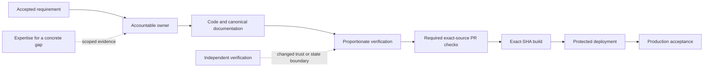

# Quality Gates

## Quality model

BetStan uses layered evidence. A passing unit test is necessary but not enough
for a cross-service feature, and a successful deployment command is not proof
that production is healthy.

## Proportionate verification

Ordinary bounded, reversible changes use relevant existing tests, inspection,
or build checks. Documentation-only work normally needs applicable
documentation checks, not application or infrastructure suites. Changes to
authorization, CI trust, release authority, physical writer ownership, data
integrity, migration, or recovery require independent verification of that
changed boundary; the author cannot supply that independent evidence.

Specialists are capabilities selected for an evidenced gap, not a compulsory
conveyor. There is no mandatory model quorum, unanimous synthesis,
review-of-review, two-phase UX handoff, or separate process continuation. Every
change still records documentation impact, and user-facing changes retain
consistency and appropriate rendered evidence. [[Agents]] explains ownership,
conditional routing, and reuse of accepted evidence.

Select review scope from the actual diff and current workflow, package, and
manifest inventories. Shared CI or contract changes include every genuine
affected consumer, not only a historical service list. Repository-only
evidence and runtime acceptance are distinct phases; each retains its
applicable checks.

After each push, inspect all native runs and check suites for the exact head,
including zero-job workflow-definition failures, before waiting for known PR
jobs. Successful local lint or existing protected jobs does not establish that
GitHub accepts every candidate workflow. The workflow guard rejects `runner`
expressions in job-level environment values; runner-dependent values belong
in step environments.

## Compatibility-stage delivery redesign

Repository policy consolidation does not replace executable controls or
reload a running agent session. The current trusted publisher, required
checks, workflow identities, event-transition rules, and first-attempt
contracts remain authoritative until a proven protected cutover.

The pre-cutover protected publisher remains `branch-policy`, consuming `production-build`
quality results. Its base-scoped `branch-policy/<base>` and
`pr-quality-gates/<base>` statuses still bind both the PR head and current
merge snapshot. The separate required `oci-validate` aggregate is unchanged.

The protected proof established so far is **non-authoritative shadow evidence**,
not full release authority. That producer landed through protected integration and promotion.
`.github/workflows/source-quality.yml` (`source-quality-shadow`) and
`.github/scripts/source-quality.js` define three
isolated jobs:

| Job | Staged responsibility |
|---|---|
| Source capture | Protected control code captures the current PR head/base, exact merge object and validator inputs without executing candidate code |
| Source-policy checks | An unprivileged exact-merge checkout runs source-policy regressions only, not the full CI scope |
| Signed aggregate | Isolated control code constructs one manifest from trusted capture outputs and native job/attempt records, then natively signs and uploads those exact bytes |

Only the aggregate receives attestation-signing permissions; candidate code
does not execute in that context. The workflow has no status-writing or
deployment permissions and no production environments. It cannot satisfy the
existing required checks. Its `workflow_dispatch` is a read-only source-proof
refresh, not production recovery.

For `pull_request_target`, native REST `run.head_sha` and `job.head_sha`
identify the event PR head, not the protected control commit or tested merge.
The proof model keeps native event identity, certificate/control identity, and
the actual tested merge separate. Valid protected control can capture a fresh
current merge after the PR base advances; its control commit need not equal
the current PR base. The captured merge still binds its exact head/base
parents and tree.

`.github/scripts/pr-source-snapshot.js` evaluates source identity independently
of title, body, labels, and edit history. Its candidate evaluator rejects
missing or mismatched selected evidence and can validate explicit no-work
proof or input-equivalent reuse with original authenticated provenance. The
shadow producer selects source-policy regressions only; it does not yet
implement the complete dependency-aware selector, full CI scope, or automatic
evidence reuse.

`.github/scripts/quality-attestation.js` uses native GitHub CLI verification of
the exact manifest bytes and checks GitHub OIDC certificate repository,
workflow, control commit/ref, event, run, and attempt identity.
Candidate-supplied claims are not certificate authority.

`.github/scripts/consume-source-quality.js` composes that verifier with the
current source evaluator without publishing any status. Its caller supplies
an independently trusted signer checkout and the downloaded manifest bytes,
not an expected signer copied from the manifest. Native artifact identity,
repository, run, attempt-specific name and expiry must match. The consumer
reconstructs selected jobs from all native attempts, rejects a newer failed
execution, and preserves older test attempts only when source capture is not
newer. A final source/execution read rejects concurrent changes. This helper's successful result explicitly remains non-authoritative.
The separate full-quality candidate described below composes it with bounded
artifact discovery and a trusted publisher; that candidate is not activated.

The local compatible implementation adds a shared selector, complete base and
merge Git-tree capture, and version-2 full-quality manifests. Each selected
suite has either its actual native execution or a direct reference to an
authenticated original execution; reused results never become current-run
jobs and cannot form provenance chains. Historical authentication does not
re-read a closed PR's current tips. The native certificate's controller must
be an eligible protected ancestor with the same independently approved
producer closure, not merely a signer named by the artifact.
Native PR association lists may disappear after merge. Missing or empty lists
do not invalidate an authenticated historical proof; contradictory nonempty
lists are rejected. Signed source, immutable merge, controller and native
execution bindings remain mandatory.

Reuse discovery is bounded. Missing, expired, incompatible or invalid evidence
is an explicit reuse miss and leaves fresh execution selected; implementation
errors are not swallowed as cache misses. Aggregation authenticates original
references again, reconstructs complete coverage and rechecks current source.
Whole-tree contract fingerprints remain conservative and non-reusable.
Selection dependencies are bounded independently of those fingerprints.
The candidate now separates ordinary package edits from unrelated deployment
contracts. Actual cross-boundary readers still select their owners: listener
inventories, specified UI assertions, Auth startup ordering, infrastructure
and control inputs. Unknown paths select the conservative full scope; unsupported
Git modes and incomplete trees fail closed.
These local contracts do not establish protected cutover or measured speed
acceptance.

### Staged full-quality integration

The candidate retains `branch-policy` as the sole status writer. Native
protected required checks select its protocol. While legacy checks remain
enforced, it preserves legacy publication and production-build completion
handling; source-quality completion is inert. The new protocol activates only
when its scoped full-quality and branch-policy contexts are enforced, with no
legacy-proof fallback.

In full-quality mode, the default-master checkout reconciles an open PR after
source-quality completion, metadata refresh, or explicit read-only dispatch. All three paths
share a per-PR writer group, including manually dispatched source runs without
native PR associations. Candidate code never executes with the publisher's
status-writing token.

The `source-quality` candidate separates trusted selection, unprivileged
selected suites, and isolated signing. The publisher requires version-2 full
coverage; a successful version-1 source-policy shadow cannot substitute.
Native run/attempt identity and artifact inventory are bounded and checked
independently. The newest failed execution cannot fall back to older success.
Source, master policy, and execution identity are rechecked around publication;
drift invalidates the statuses instead of preserving success.

Candidate statuses are `source-quality-v2/<base>` on both head and merge,
alongside temporary `pr-quality-gates/<base>` compatibility aliases.
Successful quality URLs bind both the native run and attempt. Metadata-only
edits do not change test identity; they never grant approval.

The publisher and merge helper select their verification protocol from native protected-branch
required checks, not an artifact's claimed purpose or a caller flag. Once the
new context is enforced, it requires a clean current-master verifier checkout
and independently authenticates the full proof using the same consumer as the
publisher. Missing proof, protection-read failure, stale attempt, source drift,
or invalid publisher provenance cannot fall back to legacy validation.
Legacy publication and its reader remain paired for branches still enforcing
the old protocol, including the current generic dev check names. Compatibility
does not reinterpret a source-quality run as production-build evidence.

Activation requires proving this complete stack on protected source and adding
the new enforced context before retiring old checks or producers. Local
publisher and merge-verifier regressions establish neither activation nor
production health. Existing CLI-origin ownership/automatic approval and
human-origin exact approval remain separate and unchanged.

Protected BetStan execution and native signature verification have now been
exercised end-to-end for source-policy proofs. The consumer checked actual
GitHub artifact/job records, exact protected Git inputs and the current merge
snapshot. The observed signer used the accepted default-master commit/ref,
not the PR's dev base; an independently expected dev signer was rejected.
This establishes the non-authoritative proof contract only. Full-suite
selection/reuse and publisher integration have local implementations, but
independent new-boundary review, protected execution, cutover and performance
acceptance remain unfinished; source-policy proof is not full quality or
production readiness.

Test-content changes reduce repeated fixture setup and duplicate assertion
execution while retaining all 35 OCI suites. Local fixture timings are
development evidence, not matched GitHub performance acceptance. Further
retirement and integrated validation remain; the redesign's half-baseline
wall-time and runner-consumption target has not been demonstrated.

## Pull-request CI

Pull requests to `dev` or `master` run the production validation workflow. Its
required aggregate gate includes:

| CI area | What it proves |
|---|---|
| Manifest validation | Kubernetes YAML parses successfully |
| Infrastructure hygiene | Operational infrastructure shell/YAML files are scanned for hard-coded secrets, possible public-IP literals are reported for review, and production hosts/API paths retain safe routing |
| Script validation | Deployment and runtime scripts parse and their focused contract tests pass |
| Workflow trigger guard | Production-capable workflows keep their intended triggers and trust boundaries |
| Deployment safety contracts | Readiness, activation, rollback, migration, and recovery invariants remain intact |
| Auth container smoke | A production-built Auth container typechecks, starts, and serves the expected API shape |
| Service coverage | All ten application packages run their configured coverage checks; each requires at least 80% line coverage and 80% branch coverage where branches exist |
| Client production build | The React application builds successfully in CI |

The PR-only, read-only `oci-validate` workflow selects scope first. Changes
limited to OCI health or validation-routing files check workflow syntax and run
the focused health and GHCR contracts. Other `infra/` or workflow changes
(except the separately validated `production-build.yml`) run the offline
contract suite across isolated `core`, `live`, `provenance`, `rollback`,
`governance`, and `dispatch` shards; the last two own the Copilot CLI
merge-safety, protected-operation, run-approval, exclusivity, and dispatch
suites. A single fail-closed `oci-validate`
aggregate remains the required check and succeeds only when the scope,
workflow-syntax, and selected contract jobs all succeed. Unaffected changes use
an explicit no-OCI-impact sentinel without downloading actionlint. Each full
shard has a 40-minute limit; timeout, shard failure, or partial completion is
not passing evidence. The complete local runner remains available in
deterministic serial order.

Heavy contract suites select themselves through `infra/ci/suite_gate.py`. On a
GitHub Actions `pull_request` or `push`, a guarded suite exits successfully
without running only when the first-parent diff touches none of its inputs:
the suite, files it names, and files named by the non-test scripts it reaches.
It runs whenever selection is uncertain: another event, a local run, a copied
tree, a missing parent commit, any `infra/ci/` change, or a changed `infra/` or
workflow file that no guarded suite references. Every decision prints a
`suite_gate=` line. Suites started by a running guarded suite always run. The
scheduled `ci-full-nightly` workflow runs every shard with
`BETSTAN_CI_FULL=1` on `master` as the backstop for selection mistakes.

The workflow-contract wrapper runs independent governance and data suites
concurrently, waits for every child, and fails if any child fails. Independent
dispatch fixtures use at most four isolated processes; mocked clocks, output
capture and fixture state are not shared between cases. Both fresh checkpoints
and the existing same-fixture concurrency tests remain covered.

The protected lean `production-build` selects PR coverage, Auth smoke and
runtime/deployment checks by changed paths. It starts source validation only
for opening, reopening and synchronization, not title/body edits. Master pushes
retain the full outer validation path; nested heavy suites still select their
actual inputs. Image publication follows successful required validation.

Selection and parallelism are not timing acceptance by themselves. Measure the
complete required check set, including OCI validation, rather than only its
fastest aggregate. A cancelled or unbound run is not reusable quality evidence.
Neither workflow source nor a green build proves restored runtime health.

### Actions runtime and compatible pins

JavaScript actions use an action-host Node runtime, separate from the Node
version installed for application tests. The compatible immutable pin update
selects Node 24 for nine action families; application/test `node-version: 20`,
container bases, and package versions are unchanged. Compatibility retains
authentication and masking, isolation, cache behavior, permissions,
conditions, immutable image provenance, and artifact retention.

The build-push step explicitly disables `DOCKER_BUILD_SUMMARY` and
`DOCKER_BUILD_RECORD_UPLOAD` at step scope to preserve prior defaults, without
adding a `.dockerbuild` artifact.

The Oracle/OKE configuration action remains an explicit Node 20 exception in
eight conditional callers. That remainder is deferred, not a claim of
repository-wide Node 24 completion; no Kubernetes authentication redesign or
dormant-path activation is included.

Changes to protected `production-build.yml` still require the existing
one-use authorization bound to its exact workflow blob and normal protected
promotion. Prepared pins and focused offline assertions are not rollout
acceptance: require fresh exact-SHA CI and evidence from naturally authorized
affected workflow runs. Skipped paths are not execution evidence and must not
be activated solely to demonstrate the upgrade. Corrections and reverts
retain the same protected review and one-use rules. See
[[Release Orchestration]].

### Metadata-neutral quality transitions

New version-4 markers bind the PR, source transition cutoff, exact merge
snapshot and trusted quality run. Native evidence supplies the exact head,
base, workflow and attempt. Title, body, labels and mutable update timestamps
are not v4 quality identity. Opening events can precede test-merge calculation;
the publisher captures and rechecks GitHub's live unique merge instead.

The policy publisher retains its serialized writer group and enables
[GitHub's bounded pending queue](https://docs.github.com/en/actions/how-tos/write-workflows/choose-when-workflows-run/control-workflow-concurrency).
Up to 100 policy runs can wait without newer metadata events replacing the
pending opening handler. Overflow still cancels excess arrivals, and queue
arrival order is not event chronology. Cutoff and current-source validation
therefore remain mandatory.

Cancelled non-producing metadata handlers supply no quality evidence and need
not be rerun. Completion or trusted refresh can bind an existing exact pending
marker without regenerating the merge ref. Missing markers, failed required
quality runs, source drift and conflicting bindings still fail closed.
Metadata changes never grant origin or production approval.

### Quality-transition recovery and legacy compatibility

A trusted policy publisher can leave a pending or bound transition before
its run fails. A genuine, strictly later `synchronize` or `reopened` event may
establish a fresh transition. Metadata-only `edited` events may refresh branch
policy from existing exact source evidence but cannot create a fresh source
transition or consume authorization. A completed older policy
run with `failure`, `cancelled`, or `timed_out` contributes only historical
ordering at a strictly lower cutoff, never current quality or approval
authority. Every marker still passes structural and completed-origin checks
for publisher identity, workflow, repository, PR head/base, run URL, and
timestamps; malformed or foreign history is never ignored.

The fresh lineage binds its own exact quality run and can complete only when
that run succeeds. A delayed old completion cannot satisfy it. A later or
replayed `opened`, a label event, or a manual refresh cannot create a
superseding transition. Current or higher-cutoff failed origins,
non-completed runs, and unknown, neutral, or skipped results remain unusable.

Credential boundaries, trusted status sources, exact snapshot targets and
one-use receipts remain unchanged. Existing v3 markers retain their parsing,
label-ledger authority, revocation tombstones and label/timestamp freshness:
removing then restoring a label during receipt claiming or publication cannot
restore authority. V4 does not reinterpret legacy evidence. Conflicting marker
versions at one cutoff fail closed, and tombstones remain dominant.

Recovery is not a provenance bypass. Rollback must retain v4 readers and all
required v3 ledger/freshness semantics; encoding compatibility alone is
insufficient. Use a reviewed forward correction when that floor cannot be kept.
Metadata sequencing remains governed by [[Release Orchestration]].

### Retired inactive coverage-review path

The compatibility-stage candidate removes the unused coverage-review wrapper,
`.github/coverage/` descriptor/package files, and their obsolete guard and
activation fixtures. No production workflow invokes that review feature, and
the coverage-authorization inventory is empty. The actual per-service 80%
line/branch checks are untouched; this is not coverage-gate retirement.

Two legacy files, `.github/scripts/test-coverage-matrix.js` and
`.github/scripts/test-test-coverage-matrix.js`, remain byte-identical because
the current trusted publisher compares their blobs with the trusted default.
Legacy coverage parsing also remains temporarily. Removal depends on a
compatible protected-control replacement; these retained files are not an
activation mandate or a usable standalone coverage tool after descriptor
removal. The workflow inventory still rejects the reserved `tests-telemetry`
identity. No new workflow or token wiring is enabled.

## Application test layers

### Service tests

Backend services use Jest, TypeScript checking, in-memory MongoDB, and mocked
or controlled RabbitMQ channels. Tests cover routes, models, listeners,
publishers, retries, idempotency, compatibility, and concurrency.

Fallback and error-middleware tests send repeated unmatched requests, require
the bounded structured error, and then prove a documented valid route remains
available. In Express 4, rejected async handlers are not forwarded
automatically unless the service loads an explicit integration, so catch-all
routes must be covered against process-level unhandled rejection.

### Shared package tests

The Common package must:

- compile independently;
- pass current and legacy AMQP compatibility type checks;
- pass its runtime tests;
- build the exact packed artifact that will be published.

### Client tests

The client uses React tests plus Playwright browser coverage for:

- event, live, countdown, and retained-finished states;
- separate betting boards and bet history;
- responsive desktop/tablet/mobile behavior;
- v1/v2/v3 layout variants and affected themes;
- keyboard and accessible names;
- computed alignment, overflow, touch targets, and stable control ordering;
- public Backoffice discovery and use.

Rendered evidence is required when the claim depends on geometry, clipping,
focus, or dynamic interaction. A screenshot-only assertion is not enough.

## Domain-specific gates

### Messaging and compatibility

- old and new producers/consumers can overlap safely;
- duplicated and reordered messages are harmless;
- pending publication survives restart;
- optional fields preserve historical records;
- selection and settlement identity remain ID-based.

### Live betting

- deterministic corpus tests cover realistic normal and stoppage-time
  distribution;
- simulation restart produces the same authoritative outcome;
- quote, phase, market, and settlement transitions remain monotonic; every
  material validity-window advance receives a new quote version even when odds
  stay equal, fresh markets begin at quote version 1, and non-material markers
  preserve identity and expiry;
- Moderation retains same-price quote windows independently and accepts each
  only inside its own expiry and authority interval;
- every transition exposes no more than six non-terminal products, rotation
  settles before replacement, and market versions increase before a type
  re-enters;
- products with multiple same-side options moderate and settle by exact
  selection ID, with labels preserved across every service boundary;
- full-time history never makes a false completeness claim;
- live and pre-match slips cannot mix.

### UI/UX

- hierarchy and terminology match stable product patterns;
- sibling-card headings, controls, and odds baselines align;
- ordering is stable and preserves IDs;
- all required states remain visible and understandable;
- layouts avoid overflow and unnecessary vertical growth.

## Release and production gates

Before deployment:

- the promotion is the current reviewed `master` SHA;
- every declared feature/fix commit is an ancestor of that SHA; additional
  protected commits are allowed and validated as part of the aggregate;
- build and registry provenance are complete;
- required data dry-runs, migrations, and indexes are complete;
- any bounded one-off cleanup proves exact identity, zero financial
  dependencies, a verified recovery tombstone, and post-apply absence;
- a matching rollback baseline exists;
- no competing production operation is active.

After deployment:

- workloads run the expected digests;
- health, routing, TLS, APIs, SSE, queues, consumers, and storage pass;
- accelerated live acceptance proves a stable multi-event pre-kickoff slip
  separately from a moving in-play selection governed by one event clock;
- every bounded in-play placement attempt records quote identity, expiry,
  immutable submission time, and decline details before the final success
  assertion;
- acceptance observes each fact on its owning public read model: Event proves
  phase, score, and terminal market state, while Bet history proves accepted
  quote identity, winning selection, settlement reason/sequence, and outcome;
- a non-void synthetic live market must resolve to exact `WIN` or `LOSS`;
  unexpected `VOID` fails acceptance;
- the browser acceptance journey has no page, console, API, or log errors;
- when fallback routing changes, bounded unknown-route probes return the
  application error, documented REST/SSE routes remain healthy, and target-pod
  restart counts do not change;
- activation is committed only after its bounded acceptance succeeds.

## Evidence rules

- Evidence belongs to an exact immutable SHA.
- Plain-language titles aid review but are not quality or approval authority.
  Legacy merge-helper presentation checks still apply until replaced.
- A skipped, stale, pending, unrelated, or branch-name-only check is not
  success.
- A rerun cannot replace first-attempt provenance when the contract requires
  attempt one.
- Reviewers do not approve their own implementation.
- Corrections return to the same logical owner and gate.
- Release documentation records scope, exclusions, validation, risk, release
  impact, rollback, and remaining work.

Protected-workflow declarations remain PR/ref/blob-scoped, not literal
head-SHA grants. Each use still verifies the actual current head, base and
merge snapshot, receipt anchor, scope and operation gates, required fresh CI
and applicable first-attempt provenance. Permitted source deltas belong in
review evidence, not new declaration fields.

A protected-workflow declaration can identify one exact PR number or, when the
number cannot be reserved safely, the first eligible open PR matching its
exact repository, head repository, refs, and workflow blobs. Selector matches
require a PR transition and bound quality run created after issuance. Receipt
and quality-success publication require exactly one matching candidate in the
complete open-PR inventory and revalidate the live head, base, and control
refs, complete PR snapshot, and `dev` ancestry over `master` for promotion.
Source and promotion selectors remain separate one-use authorities and receipt
contexts; closed, stale, pre-issuance, ambiguous, or consumed matches grant no
authority and fail closed.

An ancestry-only PR into `dev` can retain an already-authorized workflow when
its base, head and test-merge trees are identical. This narrow inheritance
rule verifies the live protected refs, original integrated source and full
workflow blob, complete trusted publisher receipt, and one successful exact
first-attempt source quality run and aggregate gate. GitHub may omit native
run associations after the source merges; receipt-backed historical proof
allows absence but never contradictory associations. It does not relax the
current PR's required associations or exact transition/run binding.
Inheritance writes no receipt states. Its proof, protected refs and declaration
expiry are revalidated around success publication; changed or inconclusive
evidence invalidates success. Content-changing PRs and promotions cannot use
this exception.

A workflow authorization receipt may be resumed only when its exact ledger is
already the fully validated `pending` to `success` sequence for the same
branch-policy run URL. Resumption reconstructs the acknowledged ledger and
writes no additional receipt states. Before any success-capable publication,
it repeats authority, exact PR snapshot, selector uniqueness, protected-ref,
ancestry, freshness and expiry, and shared-budget checks. Partial, malformed,
foreign, conflicting, or different-run receipts remain consumed and are
rejected fail closed. Legacy coverage receipts remain non-resumable.

The compatibility-stage publisher correction keeps one shared 30-second
allowance for receipt/selector network IO and retry waits. Unrelated full
quality revalidation no longer consumes that allowance. Per-request
cancellation and cumulative IO exhaustion remain enforced; no timeout is
increased. The focused regression distinguishes slow full revalidation from
exhausted receipt IO. This local correction is not evidence of trusted rollout.

Receipt rows remain immutable. Complete ledger validation, exact acknowledged
row identity, bounded read-back retries, and authority rechecks before writes
and after read-backs remain required. Ambiguous writes are not retried, and
same-owner resumption writes no new receipt states. A completed receipt stays
spent even if quality publication later fails.

Workflow expiry is checked on a fresh clock immediately before every receipt
POST and quality-success POST. Expiry between receipt success and quality
publication leaves the receipt spent and prevents quality success. Coverage
authorizations keep their immutable transition/run eligibility rules: an
otherwise eligible run may complete after expiry.
Historical coverage integration receipts retain full validation, with their
receipt reads bounded by the shared IO allowance and per-request cap.

Receipt-protocol repair and declaration retirement follow normal protected
integration and promotion; retirement grants no replacement authority and
preserves all claim history. Integration and promotion preserve ancestry;
reconciliation is needed only when ancestry requires it, and a promotion
candidate must contain current `master`.
Replacement integration/promotion grants are reviewed and promoted separately
into trusted `master` before the consuming workflow change enters `dev`.
Provisioning alone is not merge or deployment permission.

Old CI, expiry extensions, identity resets or workflow reverts cannot bypass
these requirements. Remove declarations after their intended uses without
deleting, resetting or reinterpreting receipt history.

Independently verified immutable facts may be reused after binding them to
the consuming work unit's root request, exact refs, scope, and complete
changed-path and consumer coverage. Retain their original source identity;
stale results, sibling-worktree assertions, and unverifiable summaries are
not authority. Reuse does not replace fresh mutable-ref, current-source,
local-state, or authority checks at required boundaries, or required
exact-SHA CI. Repeat substantive review when changed substantive evidence, an
unresolved finding, or a concrete scope risk requires it, not for an unchanged
report.

### Non-regression acceptance

Preserving working behavior is an acceptance obligation, not a zero-regression
guarantee. Identify the affected contracts before editing. A demonstrated fix
needs a targeted failing regression, positive compatibility cases for the
working path, and the relevant existing negative cases. Run focused checks
and the genuinely required regression and CI tiers; neither prose assertions
nor unnecessary duplicate full-suite runs improve the evidence.

A known regression, unexplained behavior change, or missing required proof
prevents readiness. Report actual results and unrun checks explicitly.
Independent evidence for changed trust/state boundaries remains required; routine
routing or design acceptance cannot turn a failed technical gate green. See
[[Agents]] for bounded corrections and review triggers.

## Documentation quality

Documentation-impact evidence is mandatory for every change; a separate
public-wiki supporting unit is not. Canonical wiki pages are reviewed source
files, and relevant changes join the complete candidate in the same pull
request as the behavior they describe, before source acceptance and applicable
independent verification. Their tests require the expected handbook pages and
navigation, and reject known classes of sensitive public content such as private authority
mechanics, user-specific paths, and globally routable infrastructure
addresses. After the exact commit merges, the authorized orchestrator, not
the wiki editor, publishes canonical pages byte-identically and verifies the
public result as described in [[Release Orchestration]]. Local documentation
readiness does not claim immutable-candidate validation or publication.

## Related pages

- [[Agents]]
- [[Security]]
- [[Release Orchestration]]
- [[UI UX Consistency]]
